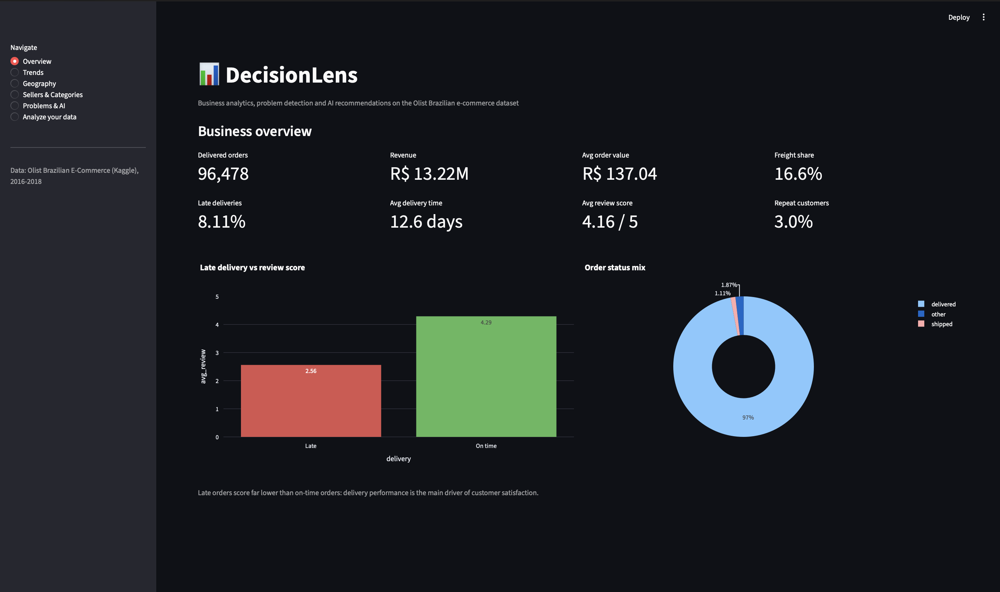
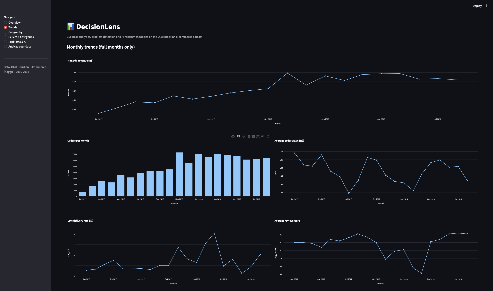
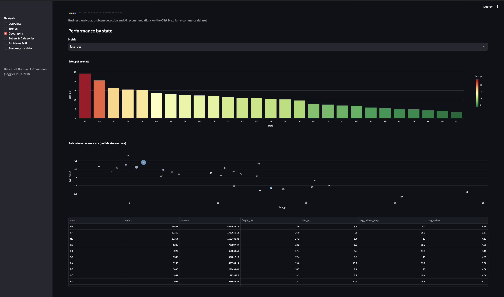
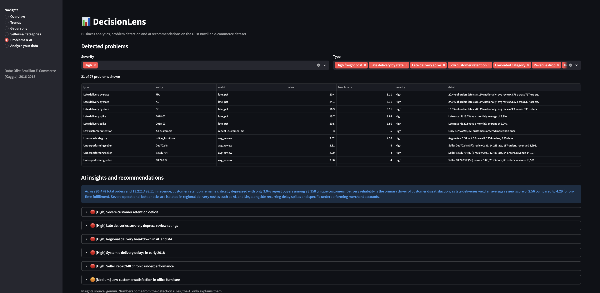
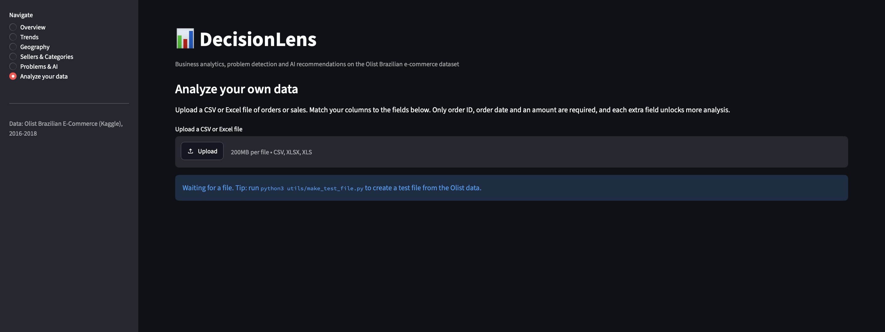

# 📊 DecisionLens

An end-to-end business analytics platform. It cleans raw transaction data, stores it in SQL, calculates KPIs, detects business problems with rules, and uses an LLM to explain root causes and recommend actions. Everything is shown in a Streamlit dashboard, and a column-mapping page lets you analyze other companies' data.



## What it does

1. **Cleans** 9 relational tables (dates, duplicates, missing values, geolocation aggregation)
2. **Stores** them in SQLite and queries them with SQL (joins, CTEs, window functions)
3. **Calculates KPIs**: revenue, average order value, delivery time, late rate, review score, repeat-customer rate
4. **Detects problems** with transparent rules (late-delivery states, spike months, weak sellers and categories, low retention)
5. **Explains them with AI**: the LLM receives only summarized numbers and returns root causes and actions. If the API is unavailable, a rule-based fallback is used.
6. **Analyzes any dataset**: upload a CSV or Excel file, map your columns, and get the same analysis for whichever fields you have

## Key findings (Olist, 2016-2018)

| Finding | Evidence |
|---|---|
| Late delivery drives bad reviews | Late orders average **2.56** stars vs **4.29** for on-time orders |
| Delivery problems are regional | AL **24.1%**, MA **20.4%**, SE **16.3%** late vs **8.11%** nationally |
| Delivery spike in early 2018 | March 2018 late rate **20.5%** vs a 6.9% monthly average |
| Weak retention | Only **3.0%** of 93,358 customers ordered more than once |
| Low-rated category | `office_furniture` scores **3.52** vs **4.16** overall |

Scale: 96,478 delivered orders, R$ 13.22M revenue, 9 tables.

## Screenshots

| Trends | Geography |
|---|---|
|  |  |

| Problems and AI insights | Analyze your own data |
|---|---|
|  |  |

## Architecture

```
raw CSVs -> cleaning.py -> SQLite -> analytics.py -> problem_detection.py -> ai_engine.py -> Streamlit
                                                                                 ^
                       upload.py (column mapping) ------------------------------+
```

| Folder / file | Purpose |
|---|---|
| `modules/cleaning.py` | Loads and cleans the raw tables |
| `database/build_db.py`, `queries.sql` | SQLite build and SQL analysis |
| `modules/analytics.py` | KPI functions |
| `modules/problem_detection.py` | Rule-based problem detection |
| `modules/ai_engine.py` | LLM insights with rule-based fallback |
| `modules/dashboard.py` | Streamlit pages |
| `modules/upload.py` | Column mapping for any dataset |

## Run it

```bash
git clone https://github.com/VISHAL-RAJA-25/DecisionLens.git
cd DecisionLens
python3 -m venv venv && source venv/bin/activate
pip install -r requirements.txt
```

1. Download the [Olist dataset](https://www.kaggle.com/datasets/olistbr/brazilian-ecommerce) into `data/raw/`
2. Run the pipeline:

```bash
python3 modules/cleaning.py
python3 database/build_db.py
python3 modules/analytics.py
python3 modules/problem_detection.py
python3 modules/ai_engine.py     # optional, needs GEMINI_API_KEY in .env
streamlit run app.py
```

## Analyze your own data

Open **Analyze your data** and upload a CSV or Excel file. Only order ID, order date and an amount are required. Each extra field (customer, category, region, delivery dates, rating) unlocks more analysis, and unavailable analyses are skipped automatically. Tested on Olist (multi-table, flattened) and Superstore (single-table).

## Tech stack

Python, pandas, SQLite, SQL, Streamlit, Plotly, Google Gemini API

## Data

Brazilian E-Commerce Public Dataset by Olist, from Kaggle (CC BY-NC-SA 4.0).

## Author

Vishal Raja · GitHub: [VISHAL-RAJA-25](https://github.com/VISHAL-RAJA-25)